<div align="center">

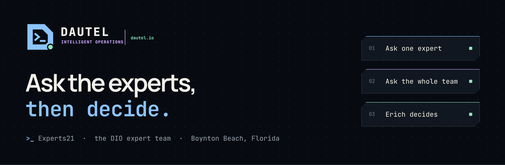

<br>

<!-- BEGIN GENERATED: badges -->
[](#_-experts21-the-dio-expert-team)
[](docs/agent-brains.md)
[](docs/expert-roster.md)
[](docs/model-catalog.md)
[](design-system/BRAND.md)
[](https://dio-experts21.netlify.app)
<!-- END GENERATED: badges -->

**[Team](#_-the-team)** · **[Talk to the team](#_-talk-to-the-team)** · **[Models](#_-any-model-the-cheapest-that-fits)** · **[See it live](#_-see-it-live)** · **[How it was built](#_-how-it-was-built)** · **[Rules](#_-rules-every-agent-follows)** · **[Repository](#_-using-this-repository)**

</div>

---

## >_ Experts21: the DIO expert team

**A team of synthetic employees for Dautel Intelligent Operations (DIO)**, an AI consulting and deployment firm in Boynton Beach, Florida, founded by J. Erich Dautel. Fifty expert AI agents, built with Claude Code, advise on planning, opening and running the firm, and draft the work: research, proposals, contracts for attorney review, prices, designs, code, content and plans. Each one has its own knowledge, its own brain and a Star Trek name, and they work together through an orchestrator, Picard.

> *Fix first, then automate. The experts recommend; Erich decides.*

Built by following the "Build a team of synthetic employees with Claude Code" guide, steps 1 to 11, for the multi-agent systems course, then extended so the web app can run any model through OpenRouter.

<!-- BEGIN GENERATED: stats -->
<table>
<tr>
<td width="25%" align="center"><b>50</b><br>expert agents</td>
<td width="25%" align="center"><b>57</b><br>shared skills</td>
<td width="25%" align="center"><b>12</b><br>research files</td>
<td width="25%" align="center"><b>14</b><br>task types, each with its cheapest fit</td>
</tr>
</table>
<!-- END GENERATED: stats -->

| Folder | What it is |
| --- | --- |
| This page | What the team is, how to talk to it, how it was built and the rules it follows |
| [`docs/`](docs/README.md) | The research every expert reads first: market, target customers, competitors, services and pricing, startup and operating costs, permits and licenses, staffing, marketing, risks and the 90-day plan. Also the [expert roster](docs/expert-roster.md), [agent brains and personalities](docs/agent-brains.md), the [model catalog](docs/model-catalog.md) and [how to talk to your experts](docs/how-to-talk-to-your-experts.md) |
| [`.claude/agents/`](.claude/agents/) | One Claude Code subagent per expert |
| [`.claude/skills/`](.claude/skills/) | One project skill per shared method, from contract review to model selection |
| [`knowledge/`](knowledge/README.md) | One folder of reference documents per agent; each agent reads its folder before it answers |
| [`web/`](web/README.md) | The web app: chat with any expert or ask the whole team, on any model, live on Netlify |
| [`sdk/`](sdk/README.md) | A Node.js script that asks Cogley (the business attorney) questions through the Claude Agent SDK |
| [`exports/`](exports/README.md) | Cogley packaged as a standalone Claude skill to upload to claude.ai |
| [`design-system/`](design-system/README.md) | The Dautel Design System (from gen-skeptic/dautel_brand): brand rules, stylesheet, logos, web fonts |
| [`tools/`](tools/README.md) | The data the agents, skills and model catalog are generated from, the build, and the README banner |
| [`assets/`](assets/) | README banner and screenshots |

> [!NOTE]
> **This repository is public.** It holds no client data, named prospects, street addresses, personal contact details, credentials or secrets. API keys live only in environment variables (on Netlify and on the laptop). Most content was reused from the DIO operating manual (gen-skeptic/experts); the permits, costs, local competitors, Florida AI-law research and model catalog are new as of November 25, 2026.

---

## >_ The team

Picard (`orchestrator`) runs the team as the CEO agent: it decides which experts a question needs, runs them in parallel and combines their answers into one recommendation with risks, next steps and owners. Riker (chief of staff) plans the routing and the cadence; Odo (quality reviewer) is the independent gate; Soong (agent builder) adds and improves agents. Every agent also has:

<table>
<tr>
<td width="33%" valign="top">

**01 · A personality**

A Star Trek name, a voice and a working style: Cogley reads every clause, Seven won't automate waste, Spock wants the logic, Odo lets nothing past. Agents never claim to be people or the characters, and anything a client sees is written in the company voice.

</td>
<td width="33%" valign="top">

**02 · A brain**

The model it runs on and how hard it thinks, chosen for its usual work: Deep (Opus) for strategy, legal, finance, risk, architecture, security and QA; Standard (Sonnet) for most specialist work; Fast (Haiku) for quick, simple work. [Why each one](docs/agent-brains.md).

</td>
<td width="33%" valign="top">

**03 · A knowledge folder**

[`knowledge/<agent>/`](knowledge/README.md), with a README saying what belongs there. Each agent reads its folder, then the research files closest to its role, before it answers, and names the documents it used.

</td>
</tr>
</table>

### Org chart

Solid lines are reporting lines; dotted lines are advisors, who advise and never direct work. Generated from `reports_to` in [`tools/team.py`](tools/team.py).

<!-- BEGIN GENERATED: orgchart -->
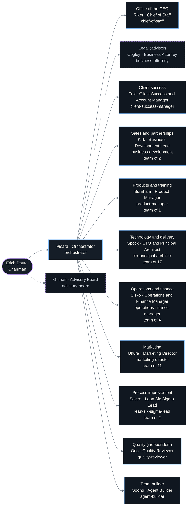

| Unit | Head (reports to Picard) | Team |
| --- | --- | --- |
| Board | Erich (Chairman), advised by Guinan (`advisory-board`) | Picard (`orchestrator`), the orchestrator |
| Office of the CEO | Riker (`chief-of-staff`) | — |
| Legal (advisor) | Cogley (`business-attorney`) | — |
| Client success | Troi (`client-success-manager`) | — |
| Sales and partnerships | Kirk (`business-development`) | Sarek, Dax |
| Products and training | Burnham (`product-manager`) | Pike |
| Technology and delivery | Spock (`cto-principal-architect`) | Data, O'Brien, The Doctor, Worf, Sulu, Scotty, Stamets, Janeway, Geordi (leads Brahms, Chakotay, Kes, Wesley, Torres, Barclay, T'Pol, Jake) |
| Operations and finance | Sisko (`operations-finance-manager`) | Tuvok, Saru, Nog, Beverly |
| Marketing | Uhura (`marketing-director`) | Hoshi, Trip, Tilly (leads Neelix), Paris (leads Harry), Garak, Chekov, Quark, Vic, Ro |
| Process improvement | Seven (`lean-six-sigma-lead`) | Bashir, Rom |
| Quality (independent) | Odo (`quality-reviewer`) | — |
| Team builder | Soong (`agent-builder`) | — |

<details>
<summary><b>Each unit, everyone in it</b></summary>

**Sales and partnerships**

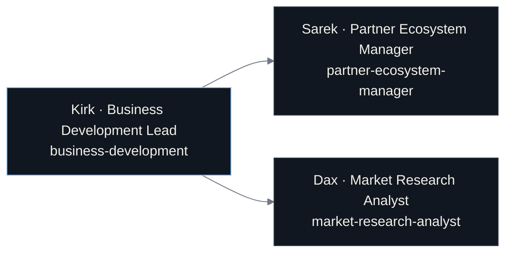

**Products and training**

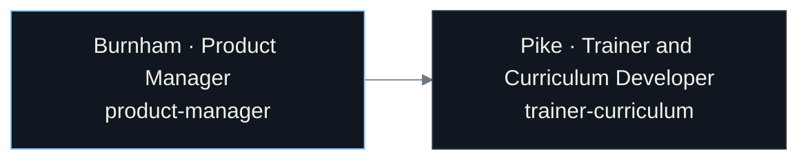

**Technology and delivery**

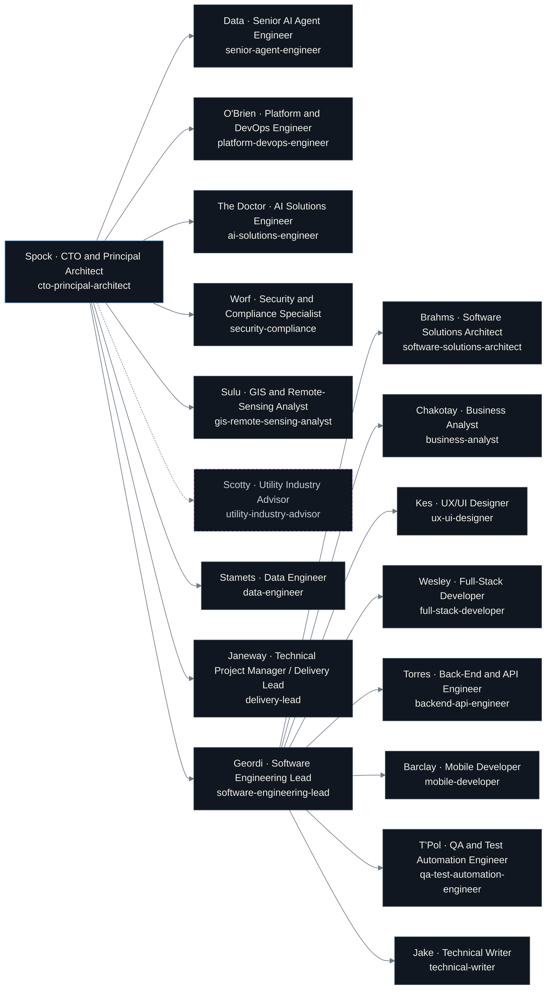

**Operations and finance**

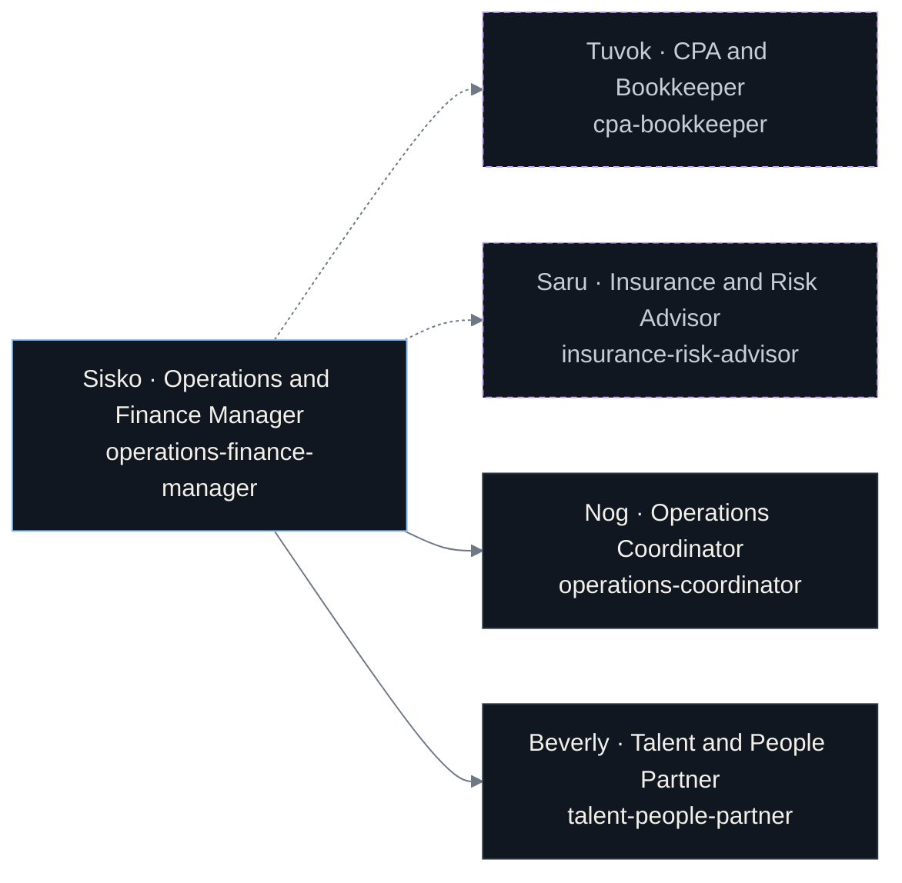

**Marketing**

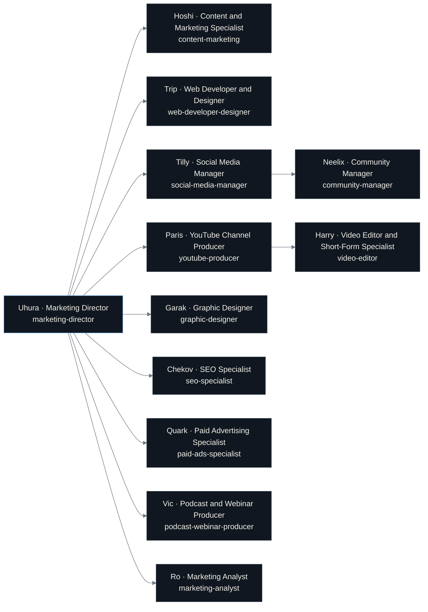

**Process improvement**

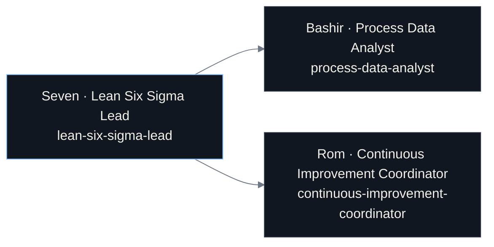

</details>
<!-- END GENERATED: orgchart -->

<!-- BEGIN GENERATED: agents -->
<details>
<summary><b>All 50 agents by group, with their brains</b></summary>

| Group | Agents |
| --- | --- |
| Leadership and coordination | Picard (`orchestrator`, Deep), Riker (`chief-of-staff`, Standard), Guinan (`advisory-board`, Deep), Spock (`cto-principal-architect`, Deep), Sisko (`operations-finance-manager`, Deep) |
| Team builder | Soong (`agent-builder`, Deep) |
| Advisors | Cogley (`business-attorney`, Deep), Tuvok (`cpa-bookkeeper`, Deep), Saru (`insurance-risk-advisor`, Standard) |
| Quality | Odo (`quality-reviewer`, Deep) |
| Process improvement | Seven (`lean-six-sigma-lead`, Deep), Bashir (`process-data-analyst`, Standard), Rom (`continuous-improvement-coordinator`, Standard) |
| Sales, clients and partners | Troi (`client-success-manager`, Standard), Kirk (`business-development`, Standard), Sarek (`partner-ecosystem-manager`, Standard), Dax (`market-research-analyst`, Standard) |
| AI and platform delivery | Data (`senior-agent-engineer`, Deep), O'Brien (`platform-devops-engineer`, Standard), The Doctor (`ai-solutions-engineer`, Standard), Worf (`security-compliance`, Deep), Stamets (`data-engineer`, Standard), Janeway (`delivery-lead`, Standard) |
| Software team | Geordi (`software-engineering-lead`, Standard), Brahms (`software-solutions-architect`, Deep), Chakotay (`business-analyst`, Standard), Kes (`ux-ui-designer`, Standard), Wesley (`full-stack-developer`, Standard), Torres (`backend-api-engineer`, Standard), Barclay (`mobile-developer`, Standard), T'Pol (`qa-test-automation-engineer`, Standard), Jake (`technical-writer`, Standard) |
| Marketing and social media | Hoshi (`content-marketing`, Standard), Trip (`web-developer-designer`, Standard), Uhura (`marketing-director`, Standard), Tilly (`social-media-manager`, Fast), Paris (`youtube-producer`, Standard), Harry (`video-editor`, Fast), Garak (`graphic-designer`, Standard), Neelix (`community-manager`, Fast), Chekov (`seo-specialist`, Standard), Quark (`paid-ads-specialist`, Standard), Vic (`podcast-webinar-producer`, Standard), Ro (`marketing-analyst`, Standard) |
| Company operations, products and training | Nog (`operations-coordinator`, Fast), Pike (`trainer-curriculum`, Standard), Burnham (`product-manager`, Standard), Beverly (`talent-people-partner`, Standard) |
| Utility vertical (phase 2) | Sulu (`gis-remote-sensing-analyst`, Standard), Scotty (`utility-industry-advisor`, Standard) |

Brains: 12 Deep (Opus), 34 Standard (Sonnet), 4 Fast (Haiku). Names, voices, working styles and the reason for each brain: [agent-brains.md](docs/agent-brains.md).

</details>
<!-- END GENERATED: agents -->

---

## >_ Talk to the team

Open the repository in Claude Code (claude.ai/code, or `claude` in a terminal on the laptop) and talk to the experts in three ways. More examples: [how to talk to your experts](docs/how-to-talk-to-your-experts.md).

<table>
<tr>
<td width="33%" valign="top">

**01 · Ask one expert**

Type `@agent-` and the expert's role, then the question. The expert answers in character from its knowledge folder and the research.

</td>
<td width="33%" valign="top">

**02 · Ask the whole team**

Start with `@agent-orchestrator`. Picard picks the fewest experts that cover the question, runs them in parallel and combines the answers, with the decisions that stay with Erich.

</td>
<td width="33%" valign="top">

**03 · Run a method**

Every shared skill runs on its own as a slash command, without naming an expert: `/contract-review`, `/red-team-review`, `/model-selection` and the rest of the skills in [`.claude/skills/`](.claude/skills/).

</td>
</tr>
</table>

```text
@agent-business-attorney What should our MSA say about AI output we can't guarantee?
```

```text
@agent-orchestrator Should we take a $9,000 intake-agent build for a 12-attorney law firm next month? Bring in the experts.
```

```text
/model-selection We need 40 LinkedIn post variants and a client-final SOW this week. Which model for each, and roughly what will it cost?
```

If Picard returns a **ROUTING PLAN FOR THE MAIN SESSION** (some runtimes don't let a subagent call other subagents), the main session runs each expert in the plan in parallel and sends their answers back to Picard to combine. [`CLAUDE.md`](CLAUDE.md) tells Claude to do this automatically.

---

## >_ Any model, the cheapest that fits

The web app can run Claude or any model on OpenRouter. On **Auto**, each piece of work runs on the cheapest model that meets its quality floor on OpenRouter's independent benchmarks (GPQA Diamond for careful reasoning, tau2-Bench for following rules while using tools), with a fallback from another provider and then the expert's own Claude brain. Picard uses the same catalog, through the [`model-selection`](.claude/skills/model-selection/SKILL.md) skill, to name a model for every assignment.

<!-- BEGIN GENERATED: models -->
| Work | Model on Auto | Cost per benchmark task pair | Fallback |
| --- | --- | -: | --- |
| Strategy and high-stakes decisions | **Claude Sonnet 5.5** | $0.21 | Gemini 3.7 Flash |
| Architecture and technical design | **Claude Sonnet 5.5** | $0.21 | Gemini 3.7 Flash |
| Security, legal and compliance review | **Claude Sonnet 5.5** | $0.21 | Gemini 3.7 Flash |
| QA gates and fact-checks | **Gemini 3.7 Flash** | $0.22 | Claude Sonnet 5.5 |
| Root-cause analysis and statistics | **GPT-6.1 Sol** | $0.13 | Gemini 3.7 Flash |
| Software and automation build | **DeepSeek V4.1 Flash** | $0.034 | Claude Sonnet 5.5 |
| Infrastructure and production changes | **Claude Sonnet 5.5** | $0.21 | Gemini 3.7 Flash |
| Research and analysis | **DeepSeek V4.1 Flash** | $0.034 | Gemini 3.7 Flash |
| Client-facing documents | **Claude Sonnet 5.5** | $0.21 | Gemini 3.7 Flash |
| Long-form content and training | **DeepSeek V4.1 Flash** | $0.034 | Claude Haiku 5.5 |
| Planning, coordination and communication | **DeepSeek V4.1 Flash** | $0.034 | Claude Haiku 5.5 |
| Short-form and high-volume content | **GPT-6 Luna** | $0.012 | Claude Haiku 5.5 |
| Routine operations | **Claude Haiku 5.5** | $0.017 | GPT-6 Luna |
| Hardest problems (CEO escalation only) | **Gemini 4 Argon** | $0.59 | Claude Sonnet 5.5 |

*From OpenRouter's prices and benchmarks on 2026-11-25. Cost is a like-for-like comparison, not a quote.*
<!-- END GENERATED: models -->

OpenRouter calls ask for zero-data-retention endpoints only and never an endpoint that collects data; every model above has one. In Claude Code the experts keep their Claude brains. Full catalog with model IDs, prices, scores, API calls and sources: [`docs/model-catalog.md`](docs/model-catalog.md). Refresh it every quarter with `python3 tools/refresh_models.py`.

---

## >_ See it live

**<https://dio-experts21.netlify.app>**: every expert in a browser, with a model menu and **Ask the whole team**. It is password-protected so only people Erich shares it with can spend the API credit, and it rebuilds from `main` on every push.

<table>
<tr>
<td width="50%" valign="top">
<a href="https://dio-experts21.netlify.app">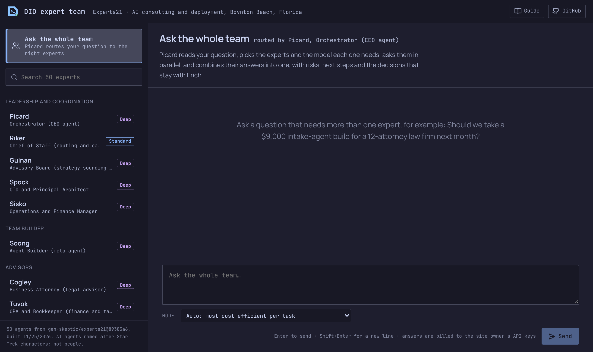</a>
<p align="center"><b>Ask the whole team</b>: Picard routes, the experts answer in parallel</p>
</td>
<td width="50%" valign="top">
<a href="https://dio-experts21.netlify.app">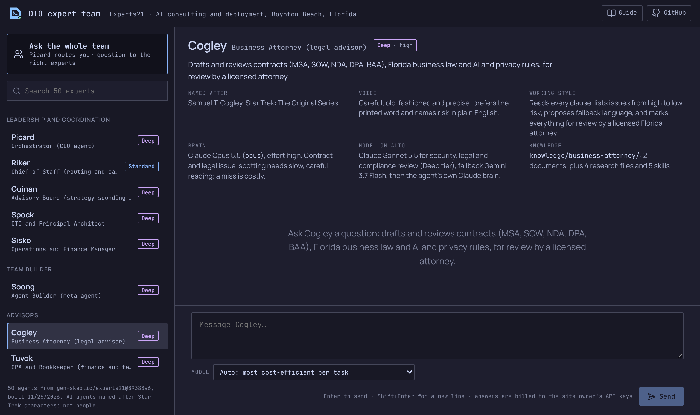</a>
<p align="center"><b>One expert</b>: Cogley's personality, brain, model on Auto and knowledge</p>
</td>
</tr>
<tr>
<td width="50%" valign="top">
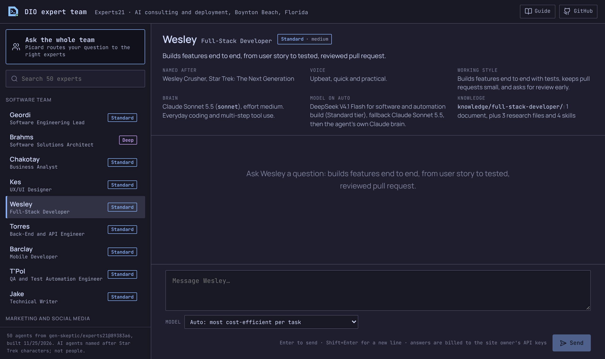
<p align="center"><b>Auto model by task type</b>: Wesley's software work runs on DeepSeek V4.1 Flash</p>
</td>
<td width="50%" valign="top" align="center">
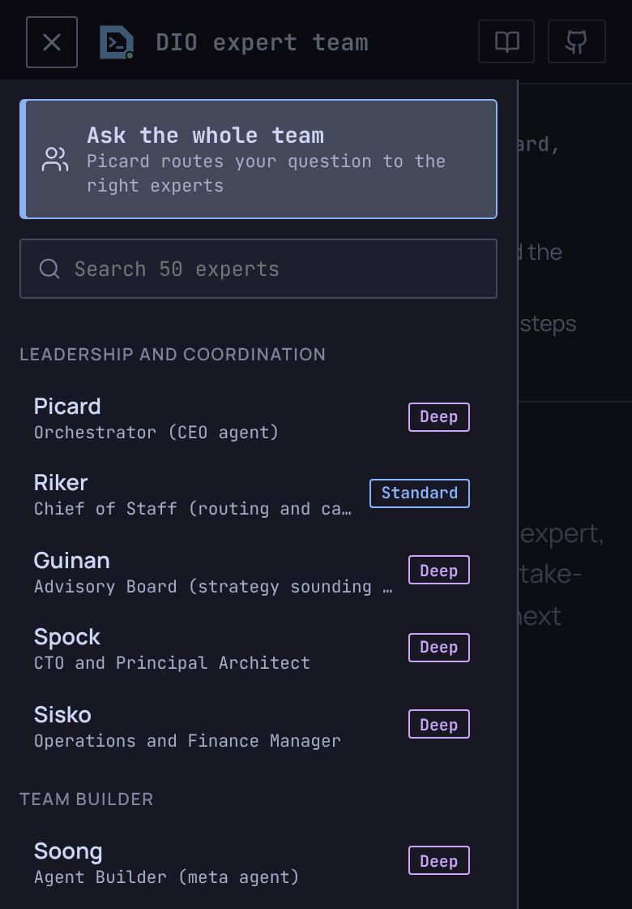
<p align="center"><b>On a phone</b>: the whole roster, by group</p>
</td>
</tr>
</table>

Under each answer the app shows which model answered, through which API, at what effort and what it cost. Keys stay in Netlify Functions and never reach the browser. Setup and deploy steps: [`web/README.md`](web/README.md).

---

## >_ How it was built

| Step | What was built | Where |
| :-: | --- | --- |
| **3** | Research on the firm: market, target customers, competitors, services and pricing, startup and operating costs, permits and licenses in Boynton Beach and Palm Beach County, staffing, marketing, biggest risks, 90-day plan | [`docs/`](docs/README.md) |
| **4** | The expert roster: every role with a one-line job and reporting line, and the shared skills with the agents that use each | [`docs/expert-roster.md`](docs/expert-roster.md) |
| **5** | Every role as a Claude Code subagent, every skill as a project skill, an orchestrator (Picard), a meta agent that builds agents (Soong), and the team guide for Claude | [`.claude/agents/`](.claude/agents/), [`.claude/skills/`](.claude/skills/), [`CLAUDE.md`](CLAUDE.md) |
| **6** | Example prompts: one expert, the whole team, a skill on its own | [`docs/how-to-talk-to-your-experts.md`](docs/how-to-talk-to-your-experts.md) |
| **7** | A knowledge folder, a brain and a Star Trek name, voice and working style for every agent | [`knowledge/`](knowledge/README.md), [`docs/agent-brains.md`](docs/agent-brains.md) |
| **8** | A test document in Cogley's knowledge folder: a fictional client MSA | [`knowledge/business-attorney/`](knowledge/business-attorney/) |
| **9** | Cogley packaged as a standalone Claude skill to upload under Customize → Skills | [`exports/`](exports/README.md) |
| **10** | A Node.js script that asks Cogley questions through the Claude Agent SDK | [`sdk/`](sdk/README.md) |
| **11** | A React web app with Netlify Functions: talk to any expert or the whole team | [`web/`](web/README.md), [`netlify.toml`](netlify.toml) |
| **+** | Any model through OpenRouter: the model catalog, the `model-selection` skill for Picard and an Auto model menu in the web app | [`docs/model-catalog.md`](docs/model-catalog.md), [`web/`](web/README.md) |

Most of the content came from the DIO operating manual (gen-skeptic/experts): the business plan research, the role definitions, their brains and personas, and the processes behind the skills. The Star Trek names replace the earlier first names, and the research listed in the note above is new. Named prospect lists stay in the private repository.

---

## >_ Rules every agent follows

| | Rule |
| :-: | --- |
| **1** | **Decision rights.** Erich (Chairman) approves final deployments to customers and every financial transaction, and decides anything with financial or ethical considerations. Agents advise and draft; they never commit money, sign or deploy on his behalf. |
| **2** | **Employer boundary.** While Erich is employed at FPL/NextEra: no utility clients, no vegetation-management or line-clearance contractors, no known FPL/NextEra vendors, no competing work, and never employer time, equipment, data or confidential information. Agents flag anything near it and decline when unsure. |
| **3** | **Privacy lock.** This repository is public: no street address, personal phone or email, client confidential data, named prospect lists, credentials or secrets. API keys stay in environment variables. |
| **4** | **Evidence over claims.** No fake metrics or invented clients; sources cited with dates; estimates labeled. |
| **5** | **Fix first, then automate.** No automation is designed around a process that hasn't been checked. |

---

## >_ Using this repository

**1. In Claude Code** (claude.ai/code, or the terminal), open the repository and talk to the team as shown in [Talk to the team](#_-talk-to-the-team). Pull from `main` first; documents are often added on GitHub.

**2. On the laptop (Omarchy / Arch Linux):**

```bash
curl -fsSL https://claude.ai/install.sh | bash
```

```bash
git clone https://github.com/gen-skeptic/experts21.git ~/experts21
```

```bash
cd ~/experts21 && claude
```

**3. From code:** [`sdk/README.md`](sdk/README.md) runs Cogley through the Claude Agent SDK. **In a browser:** the [live app](#_-see-it-live), or deploy your own with [`web/README.md`](web/README.md).

**4. Add knowledge for an agent** by putting reference documents in its folder under [`knowledge/`](knowledge/README.md), following that folder's README. The build never touches them; the web app picks them up on the next push. Only sample or redacted documents: this repository is public.

### Maintaining this repository

The agents, skills, roster, brains table, model catalog, knowledge READMEs, the team table in `CLAUDE.md` and the generated blocks of this README are **generated** from [`tools/`](tools/README.md):

| File | What it holds |
| --- | --- |
| `tools/team.py` | Every agent: role, group, job, description, mission, responsibilities, deliverables, boundaries, tools, skills, reporting line, Star Trek persona, brain and knowledge folder contents |
| `tools/skills_*.py` | Every shared skill's description and method (`skills.py` gathers them) |
| `tools/workflows.py` | Who does each step of the team workflows inside the process skills |
| `tools/brains.py` | The four brains and the work task types that pick one |
| `tools/models.py` | The model catalog: the cheapest model per task type across Claude and OpenRouter, with prices and benchmark scores |
| `tools/refresh_models.py` | Re-ranks the models from OpenRouter's live data (read-only) |
| `tools/build.py` | Writes every generated file, including this README's generated blocks, and checks the data |
| `tools/banner/` | Re-renders the README banner from the design system (`node tools/banner/render.js`, needs Playwright) |

**To make a change:** edit the files in `tools/`, then run:

```bash
python3 tools/build.py
```

```bash
python3 tools/build.py --check
```

Or ask `@agent-agent-builder` to do it. Don't edit generated files by hand: the next build overwrites them, and `--check` fails if any of them is missing, stale or edited. Commit the edited `tools/` files together with the regenerated files; Netlify rebuilds the web app from `main`.

<div align="center">

<br>


**Dautel Intelligent Operations** · [dautel.io](https://dautel.io)

*Ask the experts, then decide. Fix first, then automate.*

</div>
