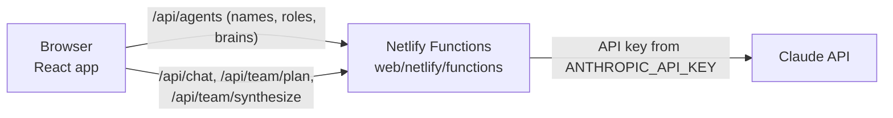

# DIO expert team web app

Talk to the experts from any browser: a sidebar with all 50 agents (Star Trek name, role, personality and brain), a chat window, and **Ask the whole team**, where Picard (`orchestrator`) routes the question to the right experts, asks them in parallel and combines their answers.



- **The agents are read from this repository at build time** (`scripts/build-agents.mjs`): every `.claude/agents/*.md` (instructions, name, voice, brain, skills), the skills they use, each `knowledge/<agent>/` folder and the `docs/` research files each agent relies on. They are packaged for the functions only; the browser bundle carries no prompts, knowledge or research.
- **The Claude API key never reaches the browser.** Every model call runs in a Netlify Function, with the key from the `ANTHROPIC_API_KEY` environment variable (yours, or the one Netlify's AI Gateway injects on credit-based plans).
- **Each agent runs on its own brain** (Opus, Sonnet or Haiku). Because Netlify stops a function after 60 seconds, the web app caps effort at medium and stops an answer at about 50 seconds. Opus and Sonnet calls turn on Anthropic's server-side refusal fallback. Each agent's context is cached, so follow-up questions cost less.
- **Team mode** is three steps, each its own short request: Picard makes a routing plan (structured JSON), the browser asks every assigned expert in parallel through `/api/chat`, and Picard combines the answers.
- **Optional password:** set `APP_PASSWORD` and the app asks for it before anyone can spend your API credit. Each function is also rate limited per visitor.
- Conversations are kept only in the visitor's own browser.

| Path | What it is |
| --- | --- |
| `src/` | The React app (Vite, TypeScript), styled with the Dautel Design System's Catppuccin Mocha theme |
| `netlify/functions/` | `agents.mts` (the sidebar), `chat.mts` (one expert, streamed), `team-plan.mts` (routing), `team-synthesize.mts` (the combined answer) |
| `server/` | Code the functions share: prompts, Claude API calls, guards and streaming |
| `scripts/build-agents.mjs` | Build step: packages the agents for the functions |
| `scripts/test-functions.mjs` | Tests the functions against a mock Claude API (no key, no cost) |
| `scripts/serve.mjs` | Runs the built app and the functions locally |
| `../netlify.toml` | Tells Netlify how to build: base `web`, command `npm run build`, publish `dist` |

## The live app

**<https://dio-experts21.netlify.app>** (Netlify project `dio-experts21` on the gen-skeptic team, Free plan), deployed November 25, 2026.

Two things to finish in the Netlify UI, because they need your accounts:

1. **Link the GitHub repository** so every push to `main` rebuilds the site: open the project, **Project configuration → Build & deploy → Continuous deployment → Link repository → GitHub → gen-skeptic/experts21**, branch `main`. Leave the build settings empty; `netlify.toml` fills them in.
2. **Choose who pays for the answers.** Netlify's **AI Gateway** is on for credit-based plans: it gives the functions Claude credentials automatically and bills your **Netlify credits** (the Free plan's AI rate limit is 90 credits a minute for the whole team, about $0.50 of model use, so team questions can be slowed or refused at busy moments). To use your own Anthropic key instead, as the guide does, add `ANTHROPIC_API_KEY` (step 4 below) and redeploy; Netlify then defers to your key. Add `APP_PASSWORD` too if the link will be shared widely.

## Deploy on Netlify

1. Go to **app.netlify.com** (sign up free with your GitHub account if you need to). Click **Add new project → Import an existing project**, then **GitHub**.
2. Search for **experts21** and click it (if it isn't listed, click **Configure the Netlify app on GitHub** and give Netlify access to the repository).
3. Give the project a name; it becomes your web address (for example `dio-experts21.netlify.app`). **Leave every build setting as it is:** `netlify.toml` fills them in (branch `main`, base directory `web`, build command `npm run build`, publish directory `dist`, functions `netlify/functions`).
4. Scroll down to **Environment variables → Add environment variables → Add key/value pairs**:
   - Key `ANTHROPIC_API_KEY`, value: your Anthropic API key (create one at **platform.claude.com → API keys**). Tick **Contains secret values**.
   - Optional: key `APP_PASSWORD`, value: a password, so only people you share it with can use the app and spend your credit.
5. Click **Deploy**. Wait about a minute, then open your new web address.

Already deployed without the key? Open the project, go to **Project configuration → Environment variables**, add the variables above, then **Deploys → Trigger deploy → Deploy project** so the functions pick them up.

Every push to `main` (a new agent, a document added to a knowledge folder) rebuilds the site by itself, so the experts stay up to date.

### Optional settings

| Variable | What it does |
| --- | --- |
| `APP_PASSWORD` | Visitors must enter it before the app calls the Claude API |
| `WEB_MAX_EFFORT` | Highest effort the web app uses: `low`, `medium` (default) or `high`. Higher is slower and may hit the 60-second limit |
| `ANTHROPIC_MODEL_OPUS`, `ANTHROPIC_MODEL_SONNET`, `ANTHROPIC_MODEL_HAIKU` | Override the model for a brain (defaults: `claude-opus-5-5`, `claude-sonnet-5-5`, `claude-haiku-5-5`) |

## Try it

Pick an expert (for example Cogley, the business attorney) and ask a question; it answers in character and names the documents it used. Or choose **Ask the whole team**: Picard picks the experts, you watch each one work, and Picard combines everything into one answer with risks, next steps and the decisions that stay with Erich. Each question is billed to the API key, so keep questions short.

## Run it on the laptop (Omarchy / Arch Linux)

Requirements: Node.js 22 or newer (`sudo pacman -S --needed nodejs npm`, or `mise use --global node@22`).

```bash
cd ~/experts21/web
```

```bash
npm ci
```

```bash
npm test
```

```bash
npm run build
```

```bash
read -rs ANTHROPIC_API_KEY && export ANTHROPIC_API_KEY
```

```bash
npm run serve
```

Open <http://127.0.0.1:8888/>. `npm test` runs the functions against a mock Claude API and costs nothing; `npm run serve` makes real, billed calls. For hot reload of the React code, keep `npm run serve` running and start `npm run dev` in a second terminal (it proxies `/api` to port 8888).

When you change an agent, a skill, a knowledge document or the research, run `npm run build` again: the agents are packaged at build time. On Netlify that happens on every push.
