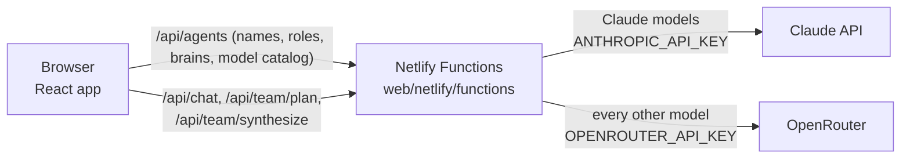

# DIO expert team web app

Talk to the experts from any browser: a sidebar with all 50 agents (Star Trek name, role, personality and brain), a chat window, a **model menu**, and **Ask the whole team**, where Picard (`orchestrator`) routes the question to the right experts, picks the model for each part, asks them in parallel and combines their answers.



- **The agents are read from this repository at build time** (`scripts/build-agents.mjs`): every `.claude/agents/*.md` (instructions, name, voice, brain, skills), the skills they use, each `knowledge/<agent>/` folder and the `docs/` research files each agent relies on. They are packaged for the functions only; the browser bundle carries no prompts, knowledge or research.
- **The API keys never reach the browser.** Every model call runs in a Netlify Function, with your keys from the `ANTHROPIC_API_KEY` and `OPENROUTER_API_KEY` environment variables.
- **No Netlify AI charges by accident.** On credit-based plans, Netlify's **AI Gateway** injects its own `ANTHROPIC_API_KEY` and `OPENROUTER_API_KEY` into functions whenever it can't see yours, and bills those calls to your Netlify credits. The app recognises the injected keys and doesn't use them (Claude models then run through OpenRouter on your key) unless you set `ALLOW_NETLIFY_AI_GATEWAY=true`.
- **The model menu** under the message box (remembered in your browser):
  - **Auto** (the default): the most cost-efficient model for the kind of work, from the [model catalog](../docs/model-catalog.md). Each agent has a usual task type (Cogley: legal review, so Claude Sonnet 5.5; Wesley: software build, so DeepSeek V4.1 Flash; Tilly: short-form posts, so GPT-6 Luna). In team mode Picard names the task type and model for each assignment, using the `model-selection` skill.
  - **Claude**: each agent's own brain (Opus, Sonnet or Haiku), as in Claude Code.
  - **One model**: any model in the catalog, listed cheapest first with its cost per benchmark task pair and price per million tokens.
- **Fallbacks:** if a model fails before it starts answering (no endpoint, rate limit, refusal, or no sign of life for 20 seconds), the next one answers and the reply says so: the task type's fallback model, then the agent's own Claude brain. Claude models go to the Claude API directly when `ANTHROPIC_API_KEY` is set (prompt caching and Anthropic's server-side refusal fallback), otherwise through OpenRouter.
- **Privacy:** OpenRouter calls ask for zero-data-retention endpoints only (`provider.zdr`) and never an endpoint that may store or train on prompts (`data_collection: "deny"`). Every model in the catalog has such an endpoint. Set `OPENROUTER_ZDR=false` to relax the first rule.
- **Every reply shows** the model, the API (and the OpenRouter provider), the task type, the effort and the cost: OpenRouter's reported cost, or an estimate from token counts and list prices for the Claude API (marked "est.").
- **Time limit:** Netlify stops a function after 60 seconds, so the web app caps effort at medium and stops an answer at about 50 seconds. Each agent's context is cached where the model supports it, so follow-up questions cost less.
- **Team mode** is three steps, each its own short request: Picard makes a routing plan (structured JSON, on the catalog's routing model), the browser asks every assigned expert in parallel through `/api/chat`, and Picard combines the answers.
- **Optional password:** set `APP_PASSWORD` and the app asks for it before anyone can spend your API credit. Each function is also rate limited per visitor.
- Conversations are kept only in the visitor's own browser.

| Path | What it is |
| --- | --- |
| `src/` | The React app (Vite, TypeScript), styled with the Dautel Design System's Catppuccin Mocha theme |
| `netlify/functions/` | `agents.mts` (the sidebar), `chat.mts` (one expert, streamed), `team-plan.mts` (routing), `team-synthesize.mts` (the combined answer) |
| `server/` | Code the functions share: prompts, `route.ts` (which model answers, with fallbacks), `claude.ts` (Claude API calls), `openrouter.ts` (OpenRouter calls), guards and streaming |
| `scripts/build-agents.mjs` | Build step: packages the agents and the model catalog (`docs/model-catalog.json`) for the functions |
| `scripts/test-functions.mjs` | Tests the functions against a mock Claude API and a mock OpenRouter API (no keys, no cost) |
| `scripts/serve.mjs` | Runs the built app and the functions locally |
| `../netlify.toml` | Tells Netlify how to build: base `web`, command `npm run build`, publish `dist` |

## The live app

**<https://dio-experts21.netlify.app>** (Netlify project `dio-experts21` on the gen-skeptic team, Free plan), deployed November 25, 2026.

How it is set up (November 25, 2026):

1. **The GitHub repository is linked** (gen-skeptic/experts21, branch `main`), so every push to `main` rebuilds and redeploys the site; `netlify.toml` supplies the build settings. To check or change it: **Project configuration → Build & deploy → Continuous deployment**.
2. **Your own keys pay for the answers:** `ANTHROPIC_API_KEY` (billed by Anthropic) and `OPENROUTER_API_KEY` (billed by OpenRouter) are set. Each call is billed once, by whichever key it uses. Netlify's **AI Gateway** stays out of it only while the functions can see your keys; if they can't, Netlify injects its own key, and calls made with it are billed to your **Netlify credits**. The app refuses those injected keys (see `ALLOW_NETLIFY_AI_GATEWAY` below). `APP_PASSWORD` is set too, so only people you share it with can spend that credit.

   **Check which keys the functions see:** open <https://dio-experts21.netlify.app/api/agents> and look at `providers`. `claudeSource` and `openrouterSource` say `own` (your key), `netlify-gateway` (Netlify's injected key, not used) or `none`. Values are never shown. If one says `netlify-gateway`, open **Project configuration → Environment variables**, edit that key, make sure its **scopes include Functions** and it has a value for **Production**, save, then **Deploys → Trigger deploy → Deploy project**. To stop the gateway from injecting anything at all, turn off AI features for the team in Netlify's team settings.

## Deploy on Netlify

1. Go to **app.netlify.com** (sign up free with your GitHub account if you need to). Click **Add new project → Import an existing project**, then **GitHub**.
2. Search for **experts21** and click it (if it isn't listed, click **Configure the Netlify app on GitHub** and give Netlify access to the repository).
3. Give the project a name; it becomes your web address (for example `dio-experts21.netlify.app`). **Leave every build setting as it is:** `netlify.toml` fills them in (branch `main`, base directory `web`, build command `npm run build`, publish directory `dist`, functions `netlify/functions`).
4. Scroll down to **Environment variables → Add environment variables → Add key/value pairs**:
   - Key `ANTHROPIC_API_KEY`, value: your Anthropic API key (create one at **platform.claude.com → API keys**). Tick **Contains secret values**.
   - Key `OPENROUTER_API_KEY`, value: your OpenRouter API key (create one at **openrouter.ai → Settings → API Keys**, and add credit). Tick **Contains secret values**. Without it, Auto uses only the Claude models in the catalog.
   - Optional: key `APP_PASSWORD`, value: a password, so only people you share it with can use the app and spend your credit.
5. Click **Deploy**. Wait about a minute, then open your new web address.

Already deployed without the key? Open the project, go to **Project configuration → Environment variables**, add the variables above, then **Deploys → Trigger deploy → Deploy project** so the functions pick them up.

Every push to `main` (a new agent, a document added to a knowledge folder) rebuilds the site by itself, so the experts stay up to date.

### Optional settings

| Variable | What it does |
| --- | --- |
| `APP_PASSWORD` | Visitors must enter it before the app calls any model |
| `OPENROUTER_API_KEY` | Turns on every non-Claude model in the catalog (and Claude through OpenRouter when `ANTHROPIC_API_KEY` isn't set) |
| `ALLOW_NETLIFY_AI_GATEWAY` | `true` lets the app use the keys Netlify's AI Gateway injects when yours are missing (billed to Netlify credits). Default: never |
| `OPENROUTER_ZDR` | `false` allows OpenRouter endpoints without zero data retention (still never ones that collect data). Default: zero data retention only |
| `WEB_MAX_EFFORT` | Highest effort the web app uses: `low`, `medium` (default) or `high`. Higher is slower and may hit the 60-second limit |
| `ANTHROPIC_MODEL_OPUS`, `ANTHROPIC_MODEL_SONNET`, `ANTHROPIC_MODEL_HAIKU` | Override the model for a brain (defaults: `claude-opus-5-5`, `claude-sonnet-5-5`, `claude-haiku-5-5`) |

## Try it

Pick an expert (for example Cogley, the business attorney) and ask a question; it answers in character and names the documents it used, and the line under the answer shows which model answered and what it cost. Or choose **Ask the whole team**: Picard picks the experts and a model for each, you watch each one work, and Picard combines everything into one answer with risks, next steps and the decisions that stay with Erich. Each question is billed to the API keys, so keep questions short. To compare models, ask the same question with **Auto**, **Claude** and a single model.

## Run it on the laptop (Omarchy / Arch Linux)

Requirements: Node.js 22 or newer (`sudo pacman -S --needed nodejs npm`, or `mise use --global node@22`).

```bash
cd ~/experts21/web
```

```bash
npm ci
```

```bash
npm test
```

```bash
npm run build
```

```bash
read -rs ANTHROPIC_API_KEY && export ANTHROPIC_API_KEY
```

```bash
read -rs OPENROUTER_API_KEY && export OPENROUTER_API_KEY
```

```bash
npm run serve
```

Open <http://127.0.0.1:8888/>. `npm test` runs the functions against mock Claude and OpenRouter APIs and costs nothing; `npm run serve` makes real, billed calls. For hot reload of the React code, keep `npm run serve` running and start `npm run dev` in a second terminal (it proxies `/api` to port 8888).

When you change an agent, a skill, a knowledge document or the research, run `npm run build` again: the agents are packaged at build time. On Netlify that happens on every push.
